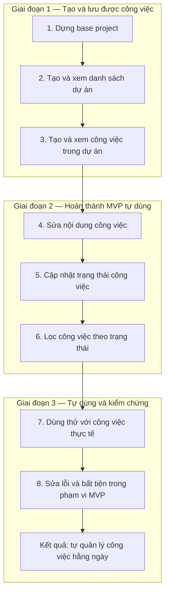

# Phần 2. Product Planning — Flow công việc và giai đoạn

**Trạng thái:** đã chốt sau phỏng vấn. Đầu ra chính là flow các box, giữ đơn giản để người dùng biết làm gì trước/sau và AI bám đúng kế hoạch.

## Mục tiêu và đầu vào

Chốt cần làm gì, phạm vi MVP, thứ tự và các giai đoạn. MVP mặc định là bản tự dùng và kiểm chứng; chưa mặc định phát hành cho người ngoài.

**Đầu vào:** Product Brief đã được review từ Discovery: người dùng, vấn đề, kết quả mong muốn, mục tiêu, ràng buộc và giả định. Không tự đặt lịch hoặc ngân sách khi chưa có thông tin.

## Trình tự thực hiện

1. **Xác định luồng chính:** người dùng cần hoàn thành việc gì, từ đâu đến kết quả nào?
2. **Liệt kê công việc cần thiết:** chức năng, nền tảng, thử nghiệm và sửa lỗi nếu đã phát hiện. Mỗi việc phải phục vụ mục tiêu hoặc chức năng đã chốt; chưa cần đoán trước mọi việc kỹ thuật.
3. **Chia phạm vi:** MVP, làm sau MVP, chưa quyết định và không làm. Ghi lý do ngắn; đánh dấu việc phục vụ học tập để cân nhắc chi phí.
4. **Sắp thứ tự:** dựa trên phụ thuộc đã biết, rủi ro, giá trị và công sức tương đối. Ưu tiên hoàn thành từng luồng sử dụng; chỉ ra lý do ngắn khi thứ tự cần giải thích.
5. **Nhóm theo giai đoạn và vẽ flow:** mỗi giai đoạn có các box công việc và kết quả cần đạt. Mũi tên chỉ thứ tự thực hiện đề xuất, không mặc định mọi mũi tên là phụ thuộc kỹ thuật bắt buộc.
6. **Người dùng review và chốt:** kiểm tra phạm vi, việc trước/sau và kết quả từng giai đoạn; AI chỉnh flow theo quyết định được chấp nhận.

## Quy ước cho flow

- Mỗi box là một chức năng hoặc công việc có kết quả rõ, ví dụ “Dựng base”, “Tạo và xem công việc”. Có thể đánh số để dễ tham chiếu.
- Nhóm các box theo giai đoạn, thể hiện rõ giai đoạn này làm gì và đạt kết quả gì.
- Làm sau MVP, chưa quyết định và không làm đặt riêng ngoài luồng hiện tại; không nối chúng như việc đã được duyệt triển khai.
- Không tách box thành tạo bảng, viết endpoint hoặc component ở bước này.
- Khi chuẩn bị thực hiện một box, mới làm rõ Requirements, thiết kế liên quan và Detailed Design, rồi chia task kỹ thuật nếu cần.
- Công việc nền tảng phục vụ chức năng; thử nghiệm cần câu hỏi, giới hạn thời gian và tiêu chí kết luận; sửa lỗi ghi hành vi mong đợi và phần bị ảnh hưởng. Chỉ ghi chú mức cần thiết cho việc lên kế hoạch.

## Ví dụ minh họa

Ví dụ ứng dụng quản lý công việc cá nhân; không phải sản phẩm đã được chọn cho playbook.

Ngoài luồng hiện tại: **sau MVP** — hạn hoàn thành, nhắc việc; **chưa quyết định** — báo cáo; **không làm** — cộng tác đội nhóm và phân quyền nhiều vai trò.

## Đầu ra tối thiểu

Khi áp dụng, lưu một `PRODUCT_PLAN.md` với:

- Mục tiêu MVP ngắn.
- Flow các box theo giai đoạn và thứ tự; có thể dùng Mermaid để lưu và chỉnh cùng tài liệu.
- Kết quả của mỗi giai đoạn, ghi ngay trong tên nhóm hoặc chú thích ngắn.
- Danh sách ngoài luồng: làm sau MVP, chưa quyết định, không làm.
- Ghi chú cần thiết về phạm vi, phụ thuộc hoặc lý do ưu tiên; thay đổi đã được chấp nhận.

Không cần một bảng quản lý task riêng, trạng thái “sẵn sàng làm rõ/sẵn sàng triển khai/bị chặn”, hoặc điều kiện bắt đầu chi tiết ở Product Planning. Những nội dung theo dõi thực thi thuộc vòng triển khai. Đây là flow thứ tự công việc, không phải sơ đồ kiến trúc hoặc sơ đồ thao tác người dùng.

## Khi thay đổi kế hoạch

Nếu có đề xuất thêm hoặc đổi chức năng, AI chỉ ra vị trí box mới/thay đổi, ảnh hưởng đến MVP, giai đoạn và thứ tự hiện tại. Người dùng duyệt trước khi cập nhật flow. Giữ đề xuất chưa duyệt ngoài luồng có hiệu lực; không tự nâng việc làm sau vào MVP.

## Phân công và checklist hoàn thành

AI đề xuất danh sách, phạm vi, thứ tự, giai đoạn và vẽ flow; chủ động chỉ ra thiếu sót nhưng không tự mở rộng phạm vi. Người dùng chọn ưu tiên, review và chốt kế hoạch. Khi triển khai, AI bám box được giao và thiết kế đã chốt.

- [ ] Mục tiêu MVP tự dùng và kiểm chứng rõ ràng.
- [ ] Flow cho thấy làm gì trước, sau và trong từng giai đoạn.
- [ ] Mỗi box có ý nghĩa và kết quả đủ rõ để tiếp tục làm rõ yêu cầu.
- [ ] Công việc nền tảng/thử nghiệm cần thiết đã được cân nhắc, không chỉ có chức năng.
- [ ] Phần làm sau, chưa quyết định và không làm được tách khỏi luồng hiện tại.
- [ ] Người dùng đã review và chốt flow; không lẫn đề xuất chưa duyệt.

**Lỗi thường gặp:** biến kế hoạch thành quản lý task quá chi tiết; vẽ mỗi box là một lớp kỹ thuật; thêm tính năng ngoài MVP; quên công việc nền tảng; cập nhật code theo ý tưởng mới nhưng giữ flow cũ.

**Mức độ cần thiết:** bắt buộc ở mức gọn; cập nhật khi thay đổi được chấp nhận.

**Bước kế tiếp:** Requirements — làm rõ hành vi và tiêu chí chấp nhận cho chức năng/luồng sắp thực hiện theo flow.
